# RenaClip

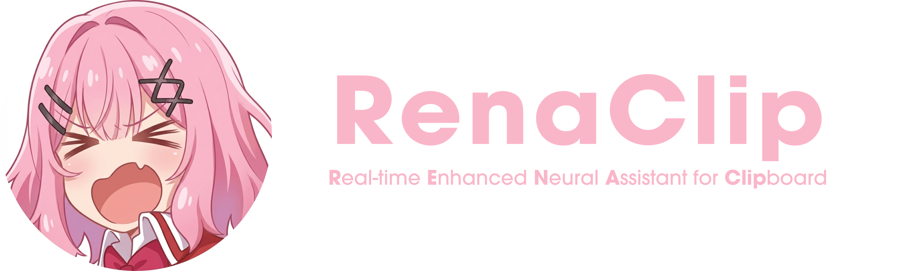

**R**eal-time **E**nhanced **N**eural **A**ssistant for **Clip**board — use **Gemini / OpenAI / DeepSeek**-powered "gems/skills" to process clipboard text with global hotkeys.


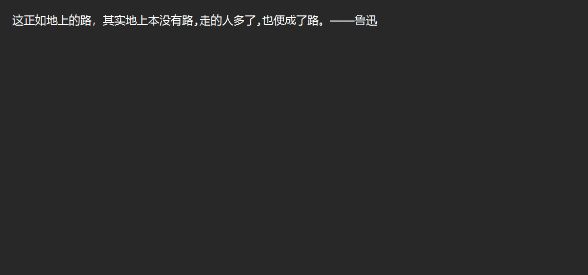

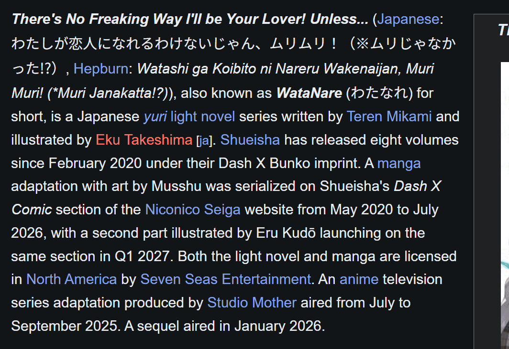

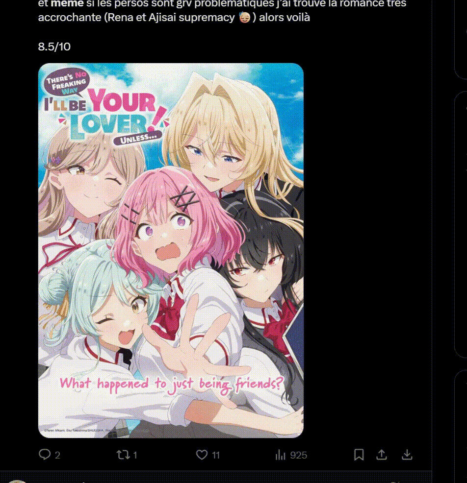

---

## Overview

RenaClip runs a clipboard service in the system tray. You define **skills** (each with a name, description, and system prompt). When you press a hotkey (e.g. **Ctrl+1**, **Ctrl+2**), the current clipboard content is sent to the corresponding skill; the model's reply is written back to the clipboard and a notification is shown.


### Supported Backends

| Backend                     | Description                                                                                                                                                    |
| --------------------------- | -------------------------------------------------------------------------------------------------------------------------------------------------------------- |
| **Gemini**            | Google Gemini via `gemini-webapi`. Supports custom Gems created/synced on Gemini.                                                                            |
| **OpenAI-compatible** | Any API compatible with OpenAI's chat completions endpoint (OpenAI, DeepSeek, Ollama, vLLM, etc.). Sends the gem's prompt as a system message on each request. |

---

## Requirements

- Python 3.12+
- Dependencies in `requirements.txt`

```bash
pip install -r requirements.txt
```

### OpenAI-compatible Backend (eg. ChatGPT/DeepSeek)

You need:

- `OPENAI_API_KEY` — your API key
- `OPENAI_BASE_URL` — endpoint URL (default: `https://api.openai.com/v1`; use `https://api.deepseek.com` for DeepSeek, `http://localhost:11434/v1` for Ollama, etc.)
- `OPENAI_MODEL` — model ID (click the refresh button to fetch available models from the endpoint)

### Gemini Backend (Unstable)

You need valid Gemini cookies configured in **Settings**:

- `GEMINI_PSID` and `GEMINI_PSIDTS` — from your Gemini session cookies
- Or enable **Log in via browser-cookie3** if already logged into [Gemini](https://gemini.google.com) in your browser
- Set `GEMINI_PSID` to `auto` to trigger a browser-based login flow (opens Edge/Chrome)

---

## Running

1. **Start the clipboard service (with tray)**

   From the project directory:

   ```bash
   python main.py
   ```

   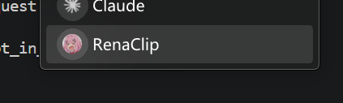

2. **Open the UI**

   Left-click the RenaClip tray icon, or choose **Open menu** from the tray menu. If the menu is already open, another window is not started.

3. **Use hotkeys**

   Copy text, then press the modifier + number for a gem (e.g. **Ctrl+1** for the first skill). The result replaces the clipboard content.

4. **Exit**
   Right-click the tray icon → **Exit**.

---

## Menu

### 1. Main interface

Gems list, **Settings**, and **Add Gem**. Each gem can be edited or deleted. Drag to reorder.

The main UI and screenshot overlay share the fixed dark/pink Qt design tokens and stylesheet in `interfaces/theme.py`: palette, Segoe UI typography, corner radius, spacing, and scrollbar styling.

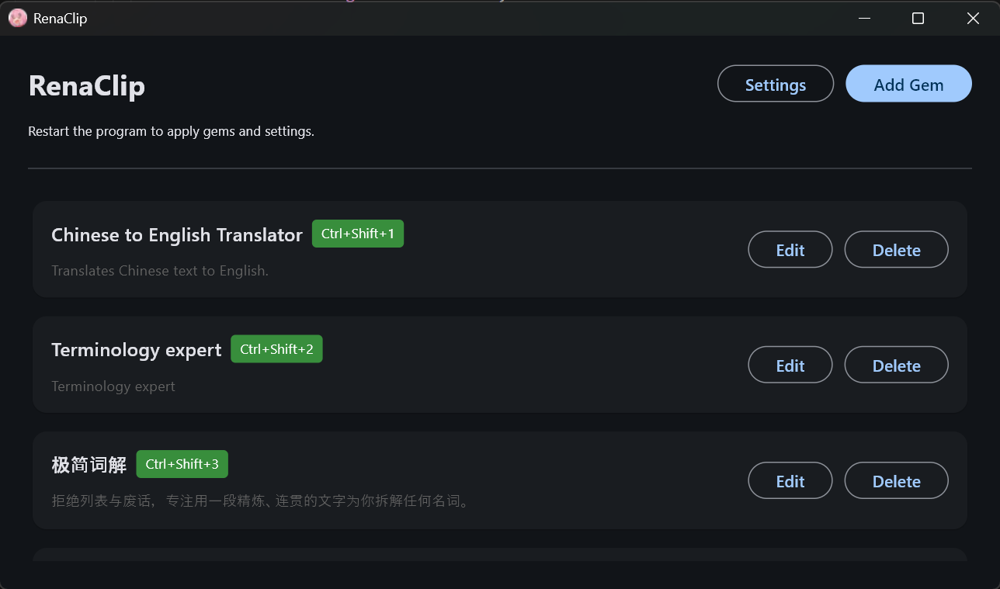

### 2. Edit / Add Skill

Set the skill **name**, **description**, and **prompt** (system instruction). Enable **Web search** to include `tools=[{"type": "web_search"}]` in that gem's OpenAI request; the selected provider must support this tool type.

Enable **Popup mode** in a Skill editor to stream its response into a topmost window beside the mouse cursor instead of updating the clipboard. The window opens immediately with a spinner and **Thinking...**, then switches to the streamed answer when text arrives; drag its title bar to move it, select text and press **Ctrl+C** or click **Copy**, and double-click the popup to close it. Closing also cancels unfinished generation. Popup mode requests streaming even when provider streaming is disabled. Each Skill stores this option locally as `popup_mode` (default `false`).

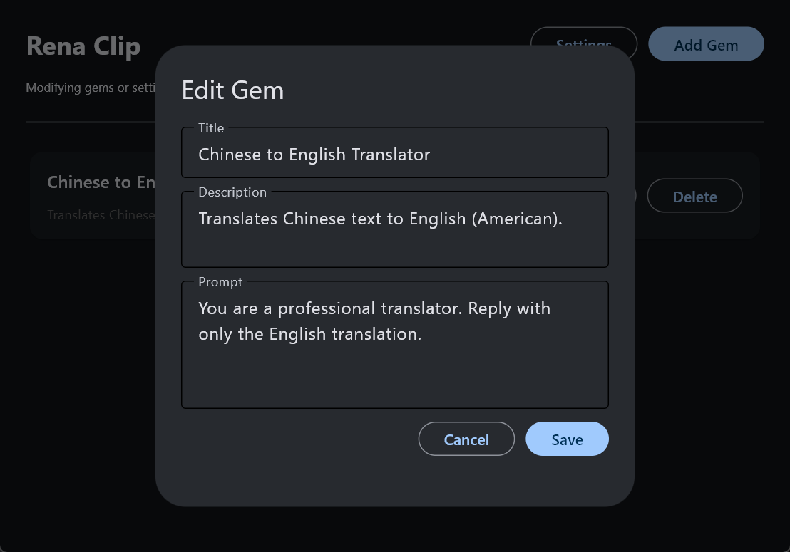

### 3. Settings

Switch between **Gemini** and **OpenAI** backends. Each section shows the relevant configuration fields for the selected backend. A refresh button next to the OpenAI model dropdown fetches available models from your API endpoint.

- **Start with Windows** — launch minimized to the tray when the current user signs in. Applied only on **Save**; unchecking and saving removes the startup entry. It uses the current-user Windows Run key and requires no administrator privileges. Source runs register the environment's Python interpreter and absolute script path; packaged runs register the EXE. If you move the app or switch from source to EXE, enable/save again from the new location to update the command.
- **Screenshot QA** — configure screenshot settings
- **Hotkey modifier** — keyboard modifier for shortcuts (e.g. `Ctrl+Shift+1`)
- **Backend** — toggle between Gemini and OpenAI-compatible

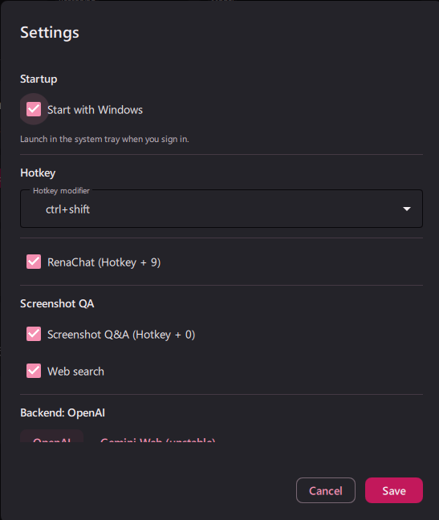

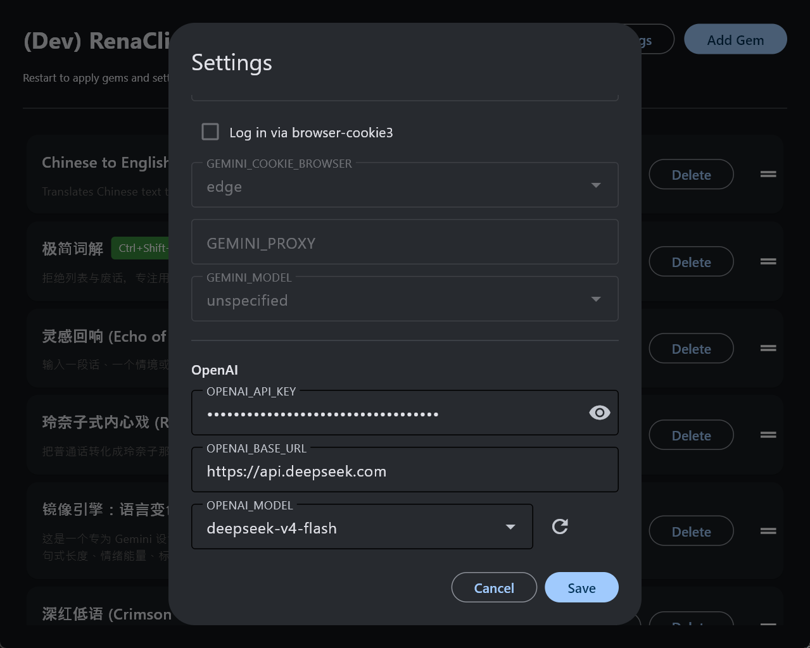

### 4. Screenshot QA

Enable **Screenshot Q&A** in **Settings** and save. Press the configured hotkey modifier plus `0` (for example, `Ctrl+Shift+0`) to start it. 

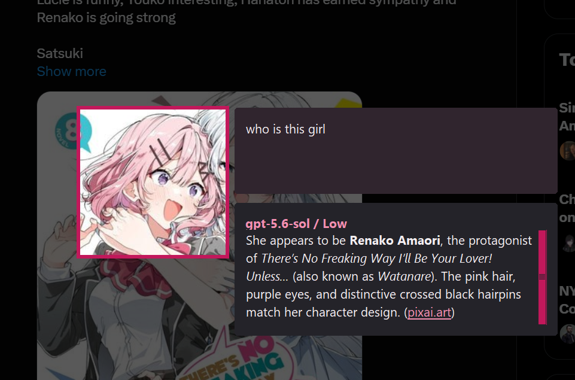

---

### 5. RenaChat

Always-on-top continuous chat with Markdown and LaTeX support. Requires a provider that supports the **Responses API**.

- **Open / recall:** Enable RenaChat in **Settings**, then press the configured modifier + **9** (e.g. `Ctrl+9`). Press again to move the window to your mouse. Drag the header to move; drag any edge to resize.
- **Chat:** Select a provider, model and reasoning effort; use **↻** to refresh models. **Enter** sends, **Shift+Enter** adds a line, and the mouse wheel scrolls history.
- **Images / search:** Click **+** or paste an image with **Ctrl+V**. Hover a thumbnail and click **×** to remove it. Check **Web search** to enable search when supported by the provider/model.
- **Hide / resume:** Press **Esc** or double-click the header/background. Generation continues while hidden; reopening preserves the conversation. History, images and drafts are saved locally across restarts.
- **Stop / reset:** **■** stops generation and restores the draft. The top-right **new-conversation icon** clears local history and starts a fresh conversation.

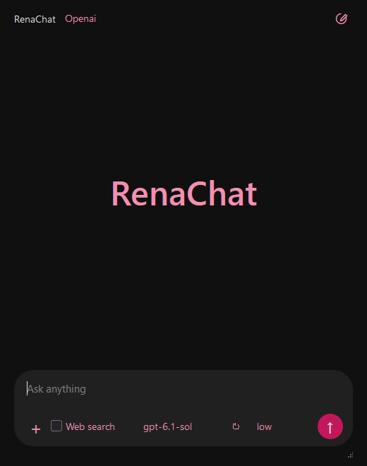

## Configuration

- Source runs use `gem_config.json` in the project directory and preserve the existing format.
- Packaged runs use `%LOCALAPPDATA%\RenaClip\gem_config.json`; place `portable.flag` beside the EXE to use EXE-adjacent configuration instead. To migrate an existing setup, copy your own config into the chosen location; release builds never bundle API keys or browser profiles.
- Backend, hotkey, provider, model and reasoning changes are reloaded on save. Each in-flight request keeps its original configuration snapshot.

### Settings reference

#### Common

| Key                 | Description                               | Default    |
| ------------------- | ----------------------------------------- | ---------- |
| `BACKEND`         | Active backend (`gemini` or `openai`) | `openai` |
| `HOTKEY_MODIFIER` | Hotkey modifier                           | `ctrl`   |

#### Gemini

| Key                           | Description                                               |
| ----------------------------- | --------------------------------------------------------- |
| `GEMINI_PSID`               | Gemini session cookie `__Secure-1PSID`                  |
| `GEMINI_PSIDTS`             | Gemini session cookie `__Secure-1PSIDTS`                |
| `GEMINI_PROXY`              | SOCKS5 proxy for Gemini (e.g.`socks5://127.0.0.1:8889`) |
| `GEMINI_MODEL`              | Gemini model ID                                           |
| `GEMINI_USE_BROWSER_COOKIE` | Login via browser-cookie3 instead of manual cookies       |
| `GEMINI_COOKIE_BROWSER`     | Browser for cookie extraction (`edge` or `chrome`)    |

#### OpenAI-compatible

| Key                 | Description                                                   |
| ------------------- | ------------------------------------------------------------- |
| `OPENAI_API_KEY`  | API key                                                       |
| `OPENAI_BASE_URL` | Base URL for the API endpoint                                 |
| `OPENAI_MODEL`    | Model ID string                                               |
| `OPENAI_MODELS`   | Cached list of available models (populated by refresh button) |

---

## Windows EXE build

Build on Windows with Python 3.12 and the project dependencies:

```powershell
python -m pip install -r requirements.txt -r requirements-build.txt
python -m PyInstaller --noconfirm --distpath out/material --workpath build/pyinstaller-qt RenaClip.spec
```

Run `out/material/RenaClip/RenaClip.exe`. Distribute the **entire RenaClip folder**, including `_internal`; users do not need Python or Conda. The spec collects Qt Quick Material/QML modules, Qt Widgets for the screenshot overlay, official Material SVG icons and backend dependencies, and excludes the former Flet/Tk runtimes and Qt WebEngine. The build uses folder mode to avoid single-file extraction delays. Configuration files, API keys and browser profiles are not included.

## License

See repository for license information.
