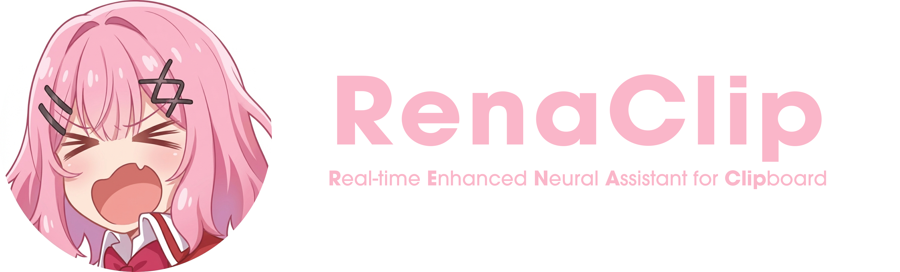
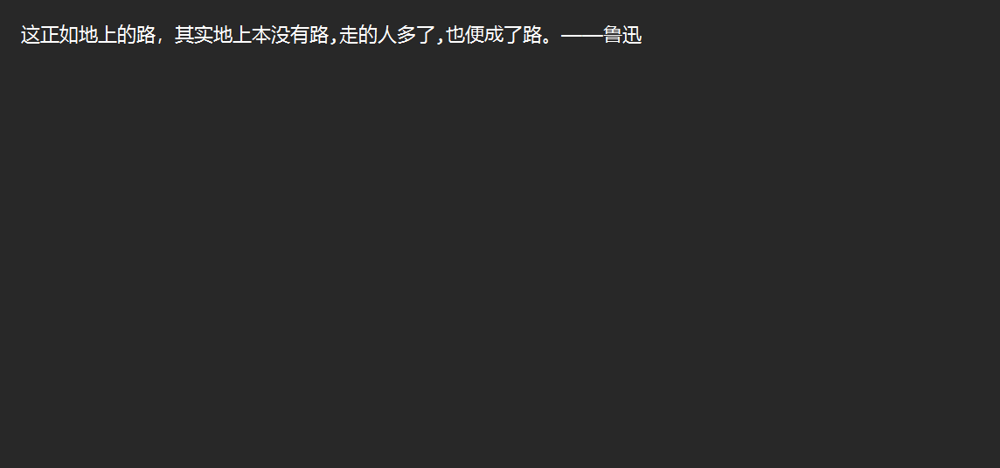
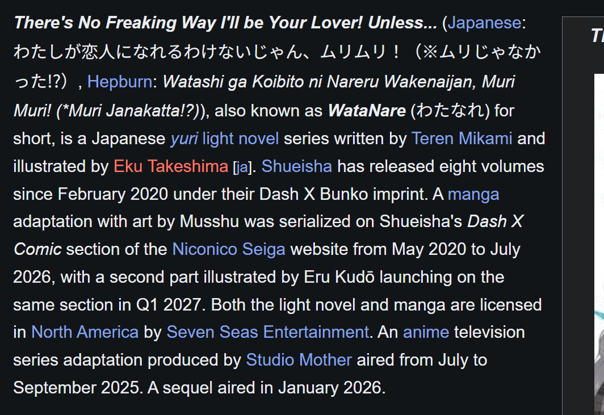
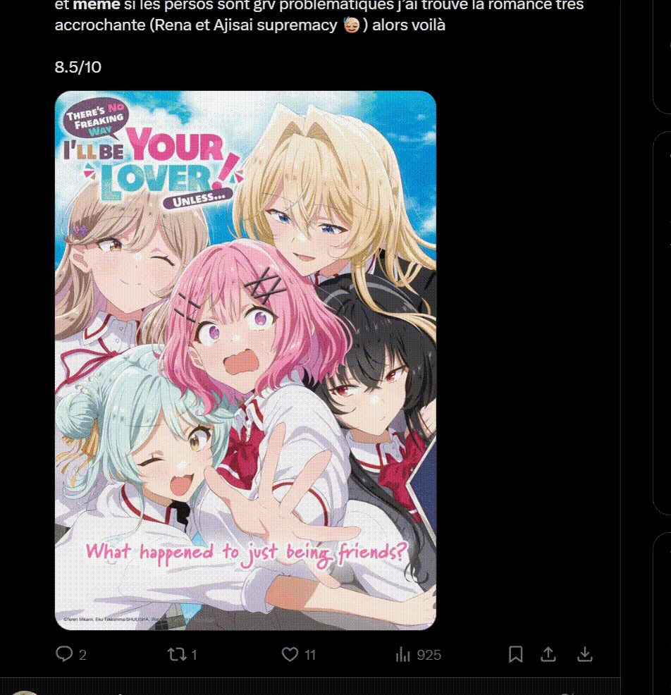
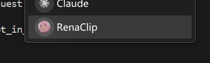
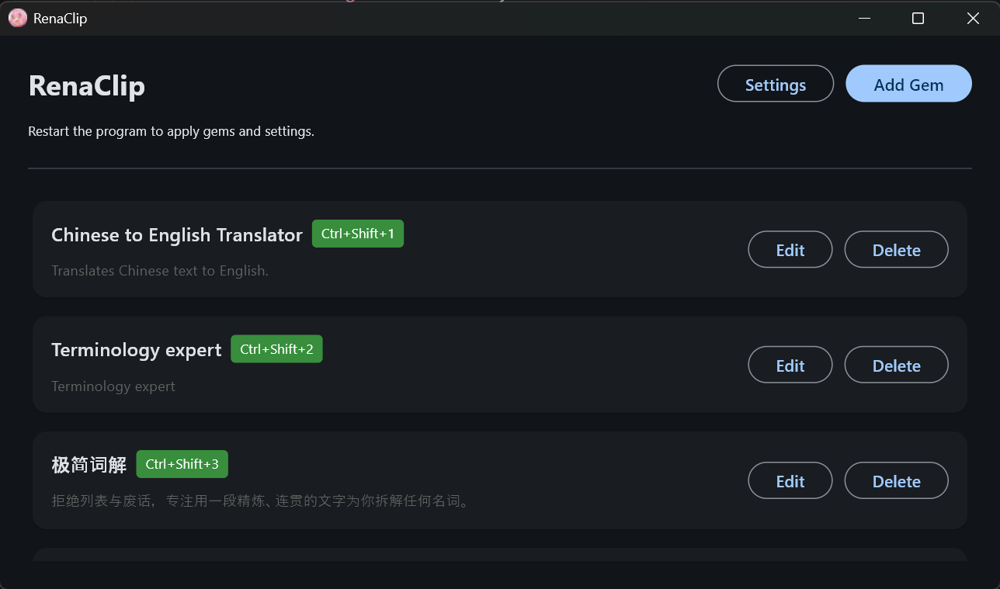
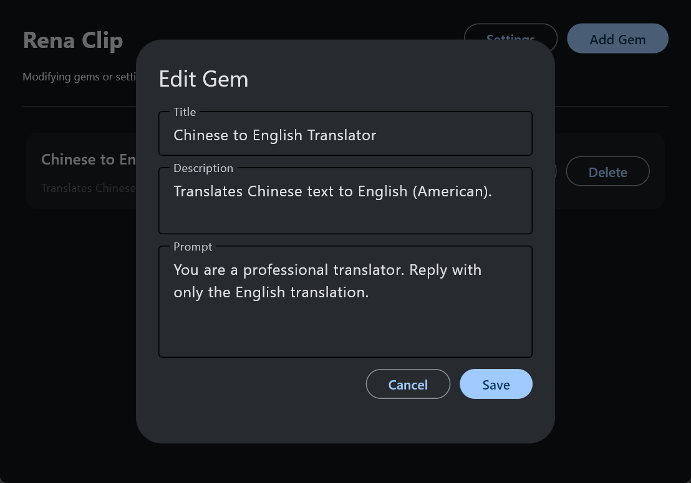
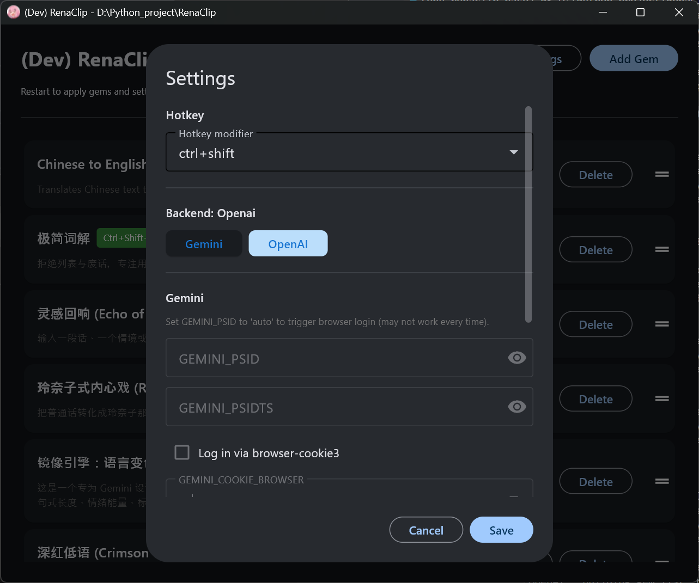
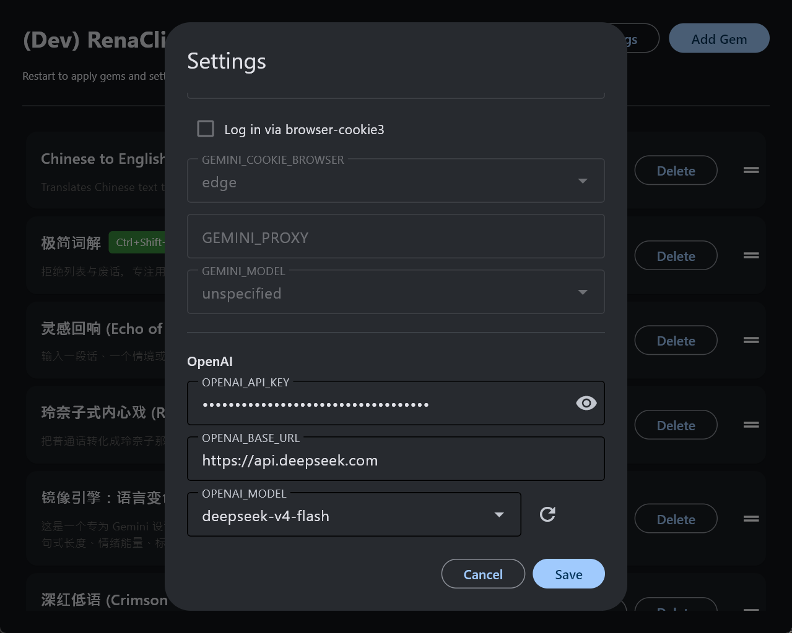
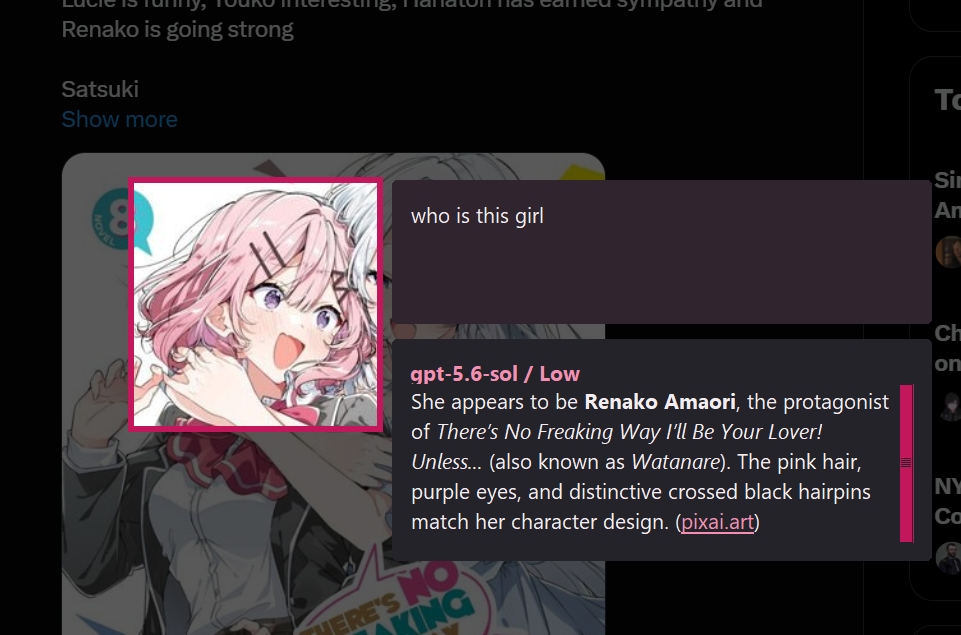

# RenaClip



**R**eal-time **E**nhanced **N**eural **A**ssistant for **Clip**board — use **Gemini / OpenAI / DeepSeek**-powered "gems/skills" to process clipboard text with global hotkeys.









---

## To-does

- [X] More friendly user interface.
- [X] Sync Gems with Gemini.
- [X] Supports multiple backends (Gemini & OpenAI-compatible).
- [X] Supports variant models.
- [X] Native Windows folder distribution with PyInstaller (PySide6 / Qt).
- [X] Display screenshot answers directly in an editable pop-up overlay.
- [ ] Stack-based clipboard.
- [ ] Supports multimodal input and response.

---

## Overview

RenaClip runs a clipboard service in the system tray. You define **skills** (each with a name, description, and system prompt). When you press a hotkey (e.g. **Ctrl+1**, **Ctrl+2**), the current clipboard content is sent to the corresponding gem; the model's reply is written back to the clipboard and a notification is shown.

- **UI**: The production main window and dialogs use **PySide6 / Qt Quick Material**, matching the compact layout shown below. Screenshot Q&A and the tray share the same Qt application and UI thread. No Flet, Flutter or Tkinter runtime is required.
- **Tray**: Service runs in the background; left-click the tray icon to open the UI, or use the menu to exit.

### Supported Backends

| Backend                     | Description                                                                                                                                                    |
| --------------------------- | -------------------------------------------------------------------------------------------------------------------------------------------------------------- |
| **Gemini**            | Google Gemini via `gemini-webapi`. Supports custom Gems created/synced on Gemini.                                                                            |
| **OpenAI-compatible** | Any API compatible with OpenAI's chat completions endpoint (OpenAI, DeepSeek, Ollama, vLLM, etc.). Sends the gem's prompt as a system message on each request. |

---

## Requirements

- Python 3.12+
- Dependencies in `requirements.txt`

```bash
pip install -r requirements.txt
```

### OpenAI-compatible Backend (eg. ChatGPT/DeepSeek)

You need:

- `OPENAI_API_KEY` — your API key
- `OPENAI_BASE_URL` — endpoint URL (default: `https://api.openai.com/v1`; use `https://api.deepseek.com` for DeepSeek, `http://localhost:11434/v1` for Ollama, etc.)
- `OPENAI_MODEL` — model ID (click the refresh button to fetch available models from the endpoint)

### Gemini Backend (Unstable)

You need valid Gemini cookies configured in **Settings**:

- `GEMINI_PSID` and `GEMINI_PSIDTS` — from your Gemini session cookies
- Or enable **Log in via browser-cookie3** if already logged into [Gemini](https://gemini.google.com) in your browser
- Set `GEMINI_PSID` to `auto` to trigger a browser-based login flow (opens Edge/Chrome)

---

## Running

1. **Start the clipboard service (with tray)**

   From the project directory:

   ```bash
   python main.py
   ```

   

2. **Open the UI**

   Left-click the RenaClip tray icon, or choose **Open menu** from the tray menu. If the menu is already open, another window is not started.

3. **Use hotkeys**

   Copy text, then press the modifier + number for a gem (e.g. **Ctrl+1** for the first skill). The result replaces the clipboard content.

4. **Exit**
   Right-click the tray icon → **Exit**.

---

## Menu

### 1. Main interface

Gems list, **Settings**, and **Add Gem**. Each gem can be edited or deleted. Drag to reorder.

The main UI and screenshot overlay share the fixed dark/pink Qt design tokens and stylesheet in `interfaces/theme.py`: palette, Segoe UI typography, corner radius, spacing, and scrollbar styling.



### 2. Edit / Add Skill

Set the skill **name**, **description**, and **prompt** (system instruction). Enable **Web search** to include `tools=[{"type": "web_search"}]` in that gem's OpenAI request; the selected provider must support this tool type.

Enable **Popup mode** in a Skill editor to stream its response into a topmost window beside the mouse cursor instead of updating the clipboard. The window opens immediately with a spinner and **Thinking...**, then switches to the streamed answer when text arrives; drag its title bar to move it, select text and press **Ctrl+C** or click **Copy**, and double-click the popup to close it. Closing also cancels unfinished generation. Popup mode requests streaming even when provider streaming is disabled. Each Skill stores this option locally as `popup_mode` (default `false`).

**弹窗模式：** 在 Skill 编辑窗口勾选 **Popup mode** 并保存。触发后立即在鼠标光标旁显示置顶弹窗，以转圈和 **Thinking...** 等待，收到文字后切换为流式回答，不自动修改剪贴板；拖动标题栏可移动，选择文字后按 **Ctrl+C** 或点击 **Copy** 可复制，双击弹窗可关闭并取消未完成生成。弹窗模式会强制请求流式输出，该选项按 Skill 保存，默认关闭。



### 3. Settings

Switch between **Gemini** and **OpenAI** backends. Each section shows the relevant configuration fields for the selected backend. A refresh button next to the OpenAI model dropdown fetches available models from your API endpoint.

- **Start with Windows** — launch minimized to the tray when the current user signs in. Applied only on **Save**; unchecking and saving removes the startup entry. It uses the current-user Windows Run key and requires no administrator privileges. Source runs register the environment's Python interpreter and absolute script path; packaged runs register the EXE. If you move the app or switch from source to EXE, enable/save again from the new location to update the command.
- **Screenshot QA** — configure screenshot settings
- **Hotkey modifier** — keyboard modifier for shortcuts (e.g. `Ctrl+Shift+1`)
- **Backend** — toggle between Gemini and OpenAI-compatible





### 4. Screenshot QA

Enable **Screenshot Q&A** in **Settings** and save. Press the configured hotkey modifier plus `0` (for example, `Ctrl+Shift+0`) to start it. Drag to select a region of the screen, then type a question in the panel on the right and press **Enter** to send; use **Shift+Enter** for a new line. A thinking indicator appears while the answer is being generated, and the completed answer can be scrolled. Click a completed Q&A bubble to edit and resubmit the question. Click outside the selected region and Q&A bubbles to select a new screenshot, or press **Esc** to exit.

<a id="screenshot-pin"></a>

**Pin the capture UI** ([中文说明](#screenshot-pin-zh)): Click the **push-pin icon in the screenshot's upper-right corner** after selection, while waiting, during generation, or after completion. The original screenshot selection, question editor, and answer bubble remain available. Only the desktop shading disappears; clicks outside these visible regions go directly to other applications. Output continues in the original browser. Drag the screenshot, answer caption, or bubble padding to move the entire group. Double-click the pinned **image** (or press **Esc** while focused) to close it and cancel unfinished generation. There are no text Pin/Close buttons. Another capture can be opened while existing groups remain pinned; pins last only for the current session. The question stays beside the selected image without reserving future answer height. Answers grow below when possible, above when space below is insufficient, or use a side fallback on constrained screens; overflow scrolls instead of moving the question.

<a id="screenshot-pin-zh"></a>

**固定原截屏界面**（[English](#screenshot-pin)）：框选后点击**图片右上角的大头针图标**即可固定，等待、生成和完成状态均可使用。原截图、问题输入框和回答气泡继续保留，仅移除桌面遮罩；可见区域以外的点击直接交给其他应用。拖动截图、回答标题或气泡留白处可移动整组界面。**双击已固定的图片**，或在界面获得焦点时按 **Esc**，可关闭并取消未完成生成；不再显示 Pin/Close 文字按钮。固定后可以再次启动截图，固定结果仅在当前应用会话内保留。问题框只按自身高度靠近选区定位，不再为长回答预留空间；回答下方放不下时向上展开，特殊狭小屏幕可回退到侧边，超长内容使用滚动而不移动问题框。



---

### 5. Continuous floating chat

<a id="continuous-chat"></a>

[中文说明](#continuous-chat-zh). Press the configured modifier plus **`-`** (for example **Ctrl+-** or **Ctrl+Shift+-**), or choose **Continuous chat** from the tray. The draggable, resizable window stays on top. Choose a Responses provider, model, and reasoning effort (`default`, `low`, `medium`, `high`). Type a message and press **Enter** to send; **Shift+Enter** inserts a new line. **Add images** attaches local pictures; **Remove images** clears pending attachments. Scroll the mouse wheel over the conversation to browse earlier turns. Double-click the header/background, or click **×**, to hide the window; reopening continues the same history, and generation continues while hidden. **Stop** cancels the current request and restores its draft. **Clear** cancels any current request and resets local history, attachments, and the response chain.

The chat uses the Responses API with `store=true`: each completed `response_id` becomes the next request's `previous_response_id`. Only successfully completed turns are committed. A provider must support stored Responses and image input for image conversations. Switching providers requires clearing the chain first; changing model/effort applies to the next turn. History, uploaded images, and the latest response ID are saved locally in `desktop_chat_history.json` beside the active configuration and survive application restarts. Provider-side response retention still determines how long an ID can be continued; if it expires, clear to start again. Clearing local history starts a fresh chain and does not delete previously stored server responses. Credentials are not written to the chat history or bundled in releases.

<a id="continuous-chat-zh"></a>

**连续悬浮对话**（[English](#continuous-chat)）：按当前修饰键加 **`-`**（例如 **Ctrl+-** 或 **Ctrl+Shift+-**），或在托盘选择 **Continuous chat**。窗口置顶，可拖动标题栏或背景移动，并可通过右下角调整大小。选择 Responses 服务商、模型和思考程度（`default`、`low`、`medium`、`high`），输入后按 **Enter** 发送，**Shift+Enter** 换行。**Add images** 上传本地图片，**Remove images** 移除待发送附件。鼠标放在对话区域滚动即可查看连续历史。双击标题栏或背景，或点击 **×**，只会隐藏窗口；重新打开可继续原对话，隐藏期间生成也会继续。**Stop** 取消当前请求并恢复草稿；**Clear** 取消请求并清空本地历史、附件和响应链。

对话使用 Responses API 的 `store=true`，每轮完成后保存 `response_id`，下一轮通过 `previous_response_id` 续接，仅成功完成的轮次写入历史。服务商需要支持已存储 Responses；图片对话还需模型支持图片输入。切换服务商需先清空响应链，模型和思考程度的修改在下一轮生效。历史、上传图片和最新响应 ID 保存在当前配置目录中的 `desktop_chat_history.json`，重启应用后仍可读取。服务端响应保留期限决定 ID 能续接多久，过期后需清空重开。本地清空不会删除服务端此前保存的响应。聊天历史不保存 API 密钥，也不会随发布包分发。

## Configuration

- Source runs use `gem_config.json` in the project directory and preserve the existing format.
- Packaged runs use `%LOCALAPPDATA%\RenaClip\gem_config.json`; place `portable.flag` beside the EXE to use EXE-adjacent configuration instead. To migrate an existing setup, copy your own config into the chosen location; release builds never bundle API keys or browser profiles.
- Backend, hotkey, provider, model and reasoning changes are reloaded on save. Each in-flight request keeps its original configuration snapshot.

### Settings reference

#### Common

| Key                 | Description                               | Default    |
| ------------------- | ----------------------------------------- | ---------- |
| `BACKEND`         | Active backend (`gemini` or `openai`) | `openai` |
| `HOTKEY_MODIFIER` | Hotkey modifier                           | `ctrl`   |

#### Gemini

| Key                           | Description                                               |
| ----------------------------- | --------------------------------------------------------- |
| `GEMINI_PSID`               | Gemini session cookie `__Secure-1PSID`                  |
| `GEMINI_PSIDTS`             | Gemini session cookie `__Secure-1PSIDTS`                |
| `GEMINI_PROXY`              | SOCKS5 proxy for Gemini (e.g.`socks5://127.0.0.1:8889`) |
| `GEMINI_MODEL`              | Gemini model ID                                           |
| `GEMINI_USE_BROWSER_COOKIE` | Login via browser-cookie3 instead of manual cookies       |
| `GEMINI_COOKIE_BROWSER`     | Browser for cookie extraction (`edge` or `chrome`)    |

#### OpenAI-compatible

| Key                 | Description                                                   |
| ------------------- | ------------------------------------------------------------- |
| `OPENAI_API_KEY`  | API key                                                       |
| `OPENAI_BASE_URL` | Base URL for the API endpoint                                 |
| `OPENAI_MODEL`    | Model ID string                                               |
| `OPENAI_MODELS`   | Cached list of available models (populated by refresh button) |

---

## Windows EXE build

Build on Windows with Python 3.12 and the project dependencies:

```powershell
python -m pip install -r requirements.txt -r requirements-build.txt
python -m PyInstaller --noconfirm --distpath out/material --workpath build/pyinstaller-qt RenaClip.spec
```

Run `out/material/RenaClip/RenaClip.exe`. Distribute the **entire RenaClip folder**, including `_internal`; users do not need Python or Conda. The spec collects Qt Quick Material/QML modules, Qt Widgets for the screenshot overlay, official Material SVG icons and backend dependencies, and excludes the former Flet/Tk runtimes and Qt WebEngine. The build uses folder mode to avoid single-file extraction delays. Configuration files, API keys and browser profiles are not included.

## License

See repository for license information.
